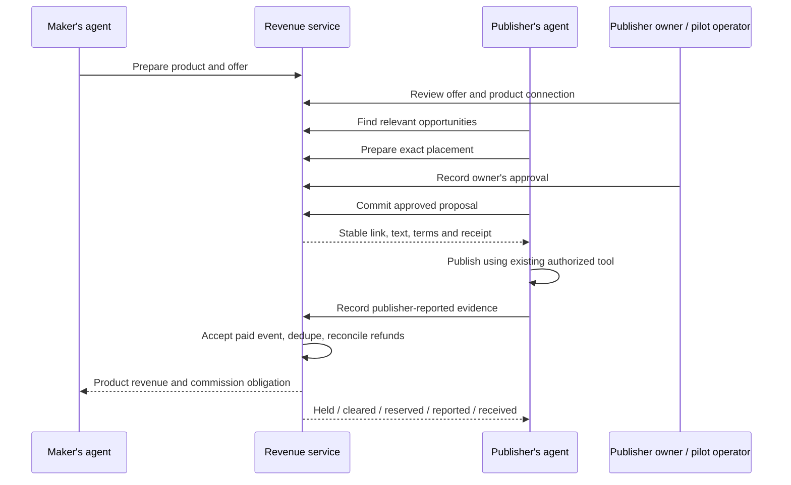

# Agent revenue POC

Implemented in Affilio on `feat/agent-revenue-poc`, 2026-09-30. Go remains 1.23. The deliverable is a working local technical proof, with a portable MCP workflow and one financial ledger.

## Run it

Requires Go, Docker Compose and Python 3. From the repository root:

```sh
./scripts/run-agent-poc.sh
```

Open <http://127.0.0.1:8086/pilot>. The script creates a dedicated PostgreSQL container on `127.0.0.1:55440`, rebuilds **only its disposable `affilio_poc` schema**, builds the API and MCP binary, and runs two separately keyed MCP processes. Keep the terminal running; Ctrl+C stops the API. Remove the demo container with `docker compose -f docker-compose.poc.yml down`.

Outputs in ignored `.local/agent-poc/`:

- `report.html` / `report.json`: result and explicit evidence limits; no keys.
- `approved-placement.md`: exact approved copy, tracked link and disclosure.
- `publisher.mcp.json`: local MCP configuration with an expiring scoped publisher key. Keep private; the launcher creates files with owner-only permissions.
- `server.log` / `setup.log`: local diagnostics.

The proof uses a simulated owner approval, seeded product readiness and signed synthetic Stripe payloads. It performs no live checkout, public publication or bank transfer. Two separate MCP processes are execution clients, not a claim that an LLM autonomously ran this script.

## Proven workflow



The public preview and relevance filter use the existing deterministic topical matcher, capped at five offers. The user's agent supplies context and copy. Weak fit returns `no_match`; the service does not generate claims or rank by commission. First supported surface: an HTTPS article on the publisher's registered domain. Imported programs retain Affilio's existing personal-link workflow; this new broker does not enroll users or verify external-network payouts.

## Authority

The pilot operator records evidence of a real owner's approval through an admin endpoint, separately from the publisher agent. This is an operator-assisted pilot, not self-service SSO or cryptographic proof of human identity. The owner must review exact copy, disclosure, surface and frozen terms. Same maker/publisher email is refused; the operator must also check real beneficial ownership.

Publisher agent keys expire after seven days and are revocable. They allow opportunity discovery, proposal preparation, task polling, owned proposal reads, approved commits, receipt recording and revenue reads. They cannot approve, confirm a payout, revoke owner consent, edit WordPress content settings or use legacy joins. Owner site keys remain separate. The new MCP skill is `distributoor-plugin/skills/distributoor-revenue/SKILL.md`.

Proposals expire after seven days. Commit locks the proposal and returns a stable receipt on retry. Revocation/expiry stops new attributable clicks; removing `?placement=...` does not bypass permission. Existing accepted clicks keep their snapshotted obligations. Publication uses the owner's own authorized tool. A receipt is labeled `publisher_reported`, includes a content hash, and cannot establish independent publication verification.

The inbox has stable IDs and receipts. Publishing is not guaranteed exactly once: an agent must inspect the owner's publishing tool before retrying an external write. Use the existing runtime's scheduler to poll; the service's finance worker runs independently of agent availability.

## HTTP contract

| Endpoint | Credential | Purpose |
|---|---|---|
| `POST /v1/revenue/preview` | None, rate limited | Context → relevant offers / no match |
| `POST /v1/revenue/opportunities` | Site or scoped agent key | Owned workflow discovery |
| `POST /v1/placements` | Site or scoped agent key | Exact copy + surface + context + offer |
| `GET /v1/placements` / `GET /v1/placements/:id` | Site or scoped agent key | Durable task inbox / owned proposal |
| `POST /v1/placements/:id/commit` | Site or scoped agent key | Approved, unexpired proposal → stable receipt |
| `POST /v1/placements/:id/receipt` | Site or scoped agent key | Report publication evidence |
| `POST /v1/placements/:id/revoke` | Owner site key | Revoke placement authority |
| `POST /v1/offer-review/placements/:id/approve` | Operator key | Record owner email, site ID and approval evidence |
| `POST /v1/offer-review/agent-access/sites/:site_id` | Admin key | Issue scoped publisher agent key |
| `POST /v1/offer-review/agent-access/:id/revoke` | Admin key | Revoke agent access |
| `POST /v1/offer-review/products/:id/connection` | Admin key | Product-scoped Stripe secret, currency and mode |
| `POST /v1/webhooks/stripe/:product_id` | Stripe signature | Durable paid/refund event ingest |
| `POST /v1/payouts/:id/confirm-received` | Owner site key | Owner records receipt of maker-reported payment |

Site/agent credentials use `X-API-Key`; admin actions use `X-Admin-Key`; placement approval and payout `mark-paid` use `X-Operator-Key`; maker APIs keep `X-Maker-Key`. Do not put operator credentials or provider secrets in agent chat. The local demo strips admin, encryption and database credentials from its two MCP process environments.

MCP adds `preview_revenue`, `find_opportunities`, `prepare_placement`, `list_agent_tasks`, `get_placement`, `commit_placement` and `record_placement_receipt`. Existing balance, history and maker tools continue to work. Verified transport: real local stdio processes. The hosted JSON-RPC endpoint remains an existing transport; new OAuth, client conformance and real Cursor/OpenClaw/Grok/Muse/dots integrations are not claimed.

## Stripe and settlement

`CONNECTION_ENCRYPTION_KEY` must be a base64-encoded 32-byte secret. Connections encrypt each product's webhook secret with AES-GCM and bind ciphertext to the product ID. Currency and test/live mode are immutable through this pilot API. Key rotation and provider account verification need an operational connection workflow before production use.

Stripe Checkout must carry the click in `client_reference_id` or `metadata.dtr`, plus `metadata.dtr_product_id`. Subscribe to `checkout.session.completed`, `checkout.session.async_payment_succeeded`, and `charge.refunded`. The global `/v1/webhooks/stripe` route returns 503; `STRIPE_WEBHOOK_SECRET` alone is no longer sufficient. Positive `paid` checkout events are eligible; unpaid/free checkouts and invoices do not create commissions. The scope is the first paid checkout, not renewals. USD/EUR/GBP are the supported two-decimal currencies.

Commission calculations use integer minor units, exclude Checkout tax/shipping, and retain the existing PostgreSQL decimal ledger. Partial refunds reverse a proportion of commission using the cumulative gross refunded amount. Rounding is cumulative, so repeated or out-of-order refunds cannot reverse twice. The initial integration assumes one successful charge per Checkout payment; additional captures/charges require a provider reconciliation adapter.

The service checks signature age, per-product credentials, signed product metadata, mode, currency, click/product ownership and attribution window. It deduplicates both webhook IDs and Stripe payment IDs. Accepted events persist before processing. Unmatched refunds and processing failures remain pending; a worker retries with backoff, including after a process restart. The first accepted event payload is canonical. Unattributed/rejected events retain an explanatory record without inventing earnings.

Payment modes stay separate in balances, history, maker totals and payout batches. Test-mode commissions are excluded from ordinary batches; `include_test_mode=true` is an explicit simulation option. Payout batches also separate makers. A database advisory transaction lock serializes financial mutations for the small pilot. Pending batches cancel on affected refunds; already paid sums remain historical cash, with a separate negative balance for clawbacks.

Balance fields: `pending`, `cleared_unpaid`, `reserved`, `payment_reported`, `paid`, plus `currency` and `mode`. `mark-paid` requires a payment reference but only records the operator's payment report. `paid` appears after the publisher owner confirms receipt. This confirmation is a recorded owner assertion, not independent bank verification. No endpoint transfers money.

The proposed maker-paid 10% fee on publisher commission is frozen in proposal terms for review. Automated fee invoicing/collection is not implemented. Direct merchant payout, funding enforcement, disputes, provider reconciliation and independent bank evidence are required before a commercial launch. No escrow or payout guarantee is offered by this code.

## Migration and verification

Apply migration `012_agent_revenue_poc.sql` once, transactionally, after 001–011. Back up an existing database and review historical Stripe duplicate payments before creating the unique payment index:

```sql
SELECT provider_object_id, COUNT(*) FROM conversions
WHERE provider='stripe' AND kind='sale'
GROUP BY provider_object_id HAVING COUNT(*)>1;
```

Do not delete duplicate financial rows to make migration pass. Reconcile them and their ledger entries first. Existing rows retain mode `legacy`; old paid entries become maker-reported until owner receipt is recorded. Historical global webhook events need explicit mapping before moving an existing merchant connection.

Run tests against a disposable database only: handler tests reset its public schema. Verification results are recorded in `docs/AGENT-REVENUE-VERIFICATION.md`.

The next pilot gate is one real paid product, one independently owned relevant article, a tested checkout reference, and a received commission. Three makers and three actual audiences are the subsequent cohort; the 50 meetup contacts remain a recruitment pool.

The optional [Jev / CLM evaluation plan](./DECISION-MODELS.md) covers semantic relevance decisions. No model integration or measured improvement is claimed; the current matcher remains the baseline.
